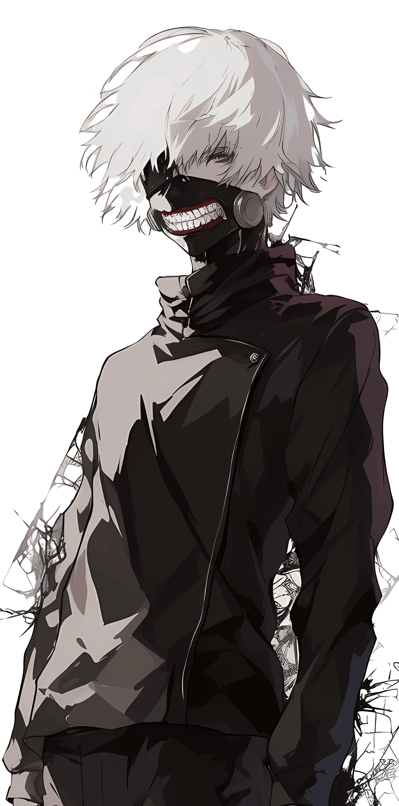

<!--
  ABOUT ME template (uncomment and edit later)

  ### About me

  

  | 
🎓 Jain University • B.Tech CSE (AI &amp; ML), 2nd year 
  |
  | --------------------------------------------------------- |
  | 🏫 Bengaluru, India (from Hosur, Tamil Nadu)              |
  | 🎯 **Goal:** ML Engineer by 2030                          |
  | 🌐 **Languages:** English, Hindi, Bengali, Tamil, Odia    |

---

 
-->

    
  
  
  
  
  
  

 

---

<h2 align="center"> Languages-Frameworks-Tools </h2>
 

<table align="center">
  <tr>
    <td align="center" width="96">
         
    </td>
    <td align="center" width="96">
         
    </td>
    <td align="center" width="96">
         
    </td>
    <td align="center" width="96">
         
    </td>
    <td align="center" width="96">
         
    </td>
    <td align="center" width="96">
         
    </td>
    <td align="center" width="96">
         
    </td>
  </tr>

  <tr>
    <td align="center" width="96">
         
    </td>
    <td align="center" width="96">
         
    </td>
    <td align="center" width="96">
         
    </td>
    <td align="center" width="96">
         
    </td>
    <td align="center" width="96">
         
    </td>
    <td align="center" width="96">
         
    </td>
    <td align="center" width="96">
         
    </td>
  </tr>

  <tr>
    <td align="center" width="96">
         
    </td>
    <td align="center" width="96">
         
    </td>
    <td align="center" width="96">
         
    </td>
    <td align="center" width="96">
         
    </td>
    <td align="center" width="96">
         
    </td>
    <td align="center" width="96">
         
    </td>
    <td align="center" width="96">
         
    </td>
  </tr>

</table>

 

---

  <h2 align="center">🏆 Hackathons &amp; Competitions 🏆</h2>
   

  <b>11 events · 3 finals · 2 podium finishes (🥇 CRCE, 🥉 TechNova) · 1 grand finale pending (KSP Datathon)</b>
    

| Event | Project | Role | Result |
|---|---|---|---|
| **KSP Datathon 2026** (Karnataka State Police × Hack2Skill) | DRISHTI | AI Engine Lead | 🏆 **Grand Finalist** · ₹10L pool · finale 29 Oct 2026, Bengaluru |
| **TechNova S3** (Unstop × ESSPL) | CrowdShield | Backend &amp; AI Lead | 🥉 **3rd place** · qualified 361 of 3,700+ teams · Championship, Bhubaneswar |
| **CRCE Hackathon 2026** | CareBridge | Team Lead, full-stack | 🥇 **1st place** |
| **Odoo Hackathon 2K26** | EcoSphere → Urban Furniture | Frontend Lead | 🚀 **Top 800 of ~20,000 teams** · Grand Finale, Gandhinagar |
| **Smart India Hackathon 2026** (DRDO PS 26051) | THERMA | UI/UX Lead | ✅ Selected participant |
| **Smart India Hackathon 2025** | InternFox | Full Stack Lead | ✅ Selected participant |
| **Bharatiya Antariksh Hackathon** (ISRO × Hack2Skill) | Idea submission | n/a | ⭐ Shortlisted · out in Round 2 |
| **Hack Spirit** (MAHE) | PRISM | Frontend Lead | Participant · Gemini AI + Google Cloud track |
| **Manipal Hackathon 2026** | RippleGuard | Frontend / DevOps | Participant · cybersecurity track |
| **Odoo × NMIT** | n/a | n/a | Participant |
| **NASA Space Apps Challenge 2026** | Space Mission Design Game | n/a | 🔥 In progress |
| **Nebius × NVIDIA Global AI Hackathon** | n/a | n/a | 🔥 In progress · submission due 30 Oct |

  <h2 align="center">🧪 Selected projects 🧪</h2>

  <b>EcoSphere</b> · <b>DRISHTI AI</b> · <b>CrowdShield</b> · <b>CareBridge</b> · <b>Urban Furniture</b> · <b>Repo Lens</b> · <b>PersonaNet / PolicySim</b> · <b>GhostEmployee</b> · <b>IdeaFlow</b> · <b>LinkSnap</b>
    
  <a href="https://github.com/Swapnil-Ghosh06?tab=repositories">Browse all repositories →</a>

<h4 align="center">made with  by <a href="https://github.com/Swapnil-Ghosh06">swapnil</a></h4>
